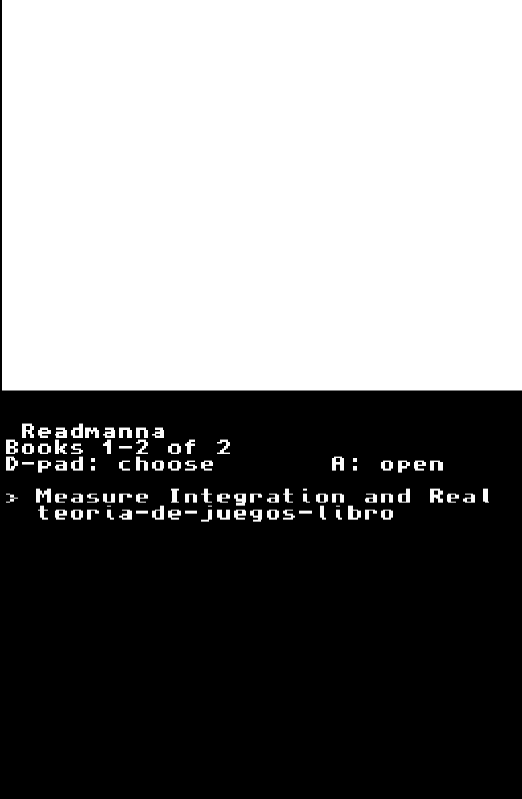
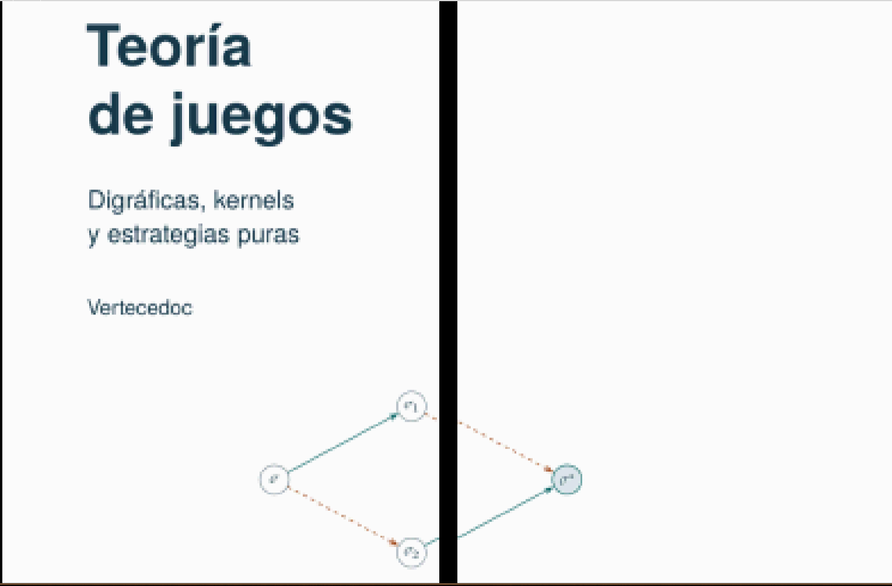
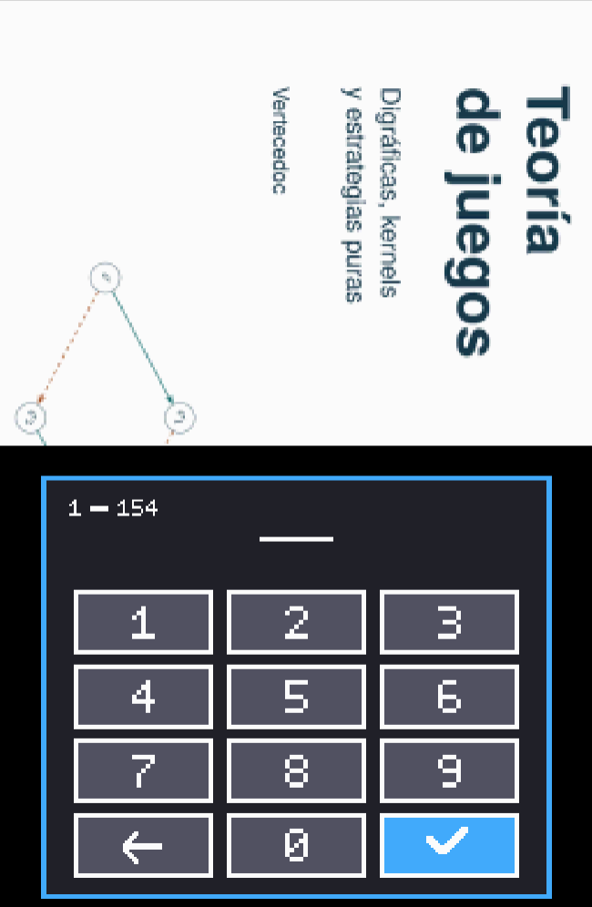
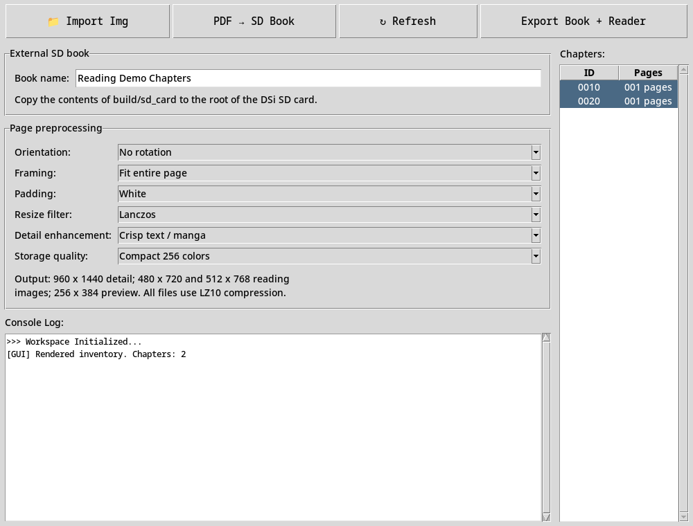
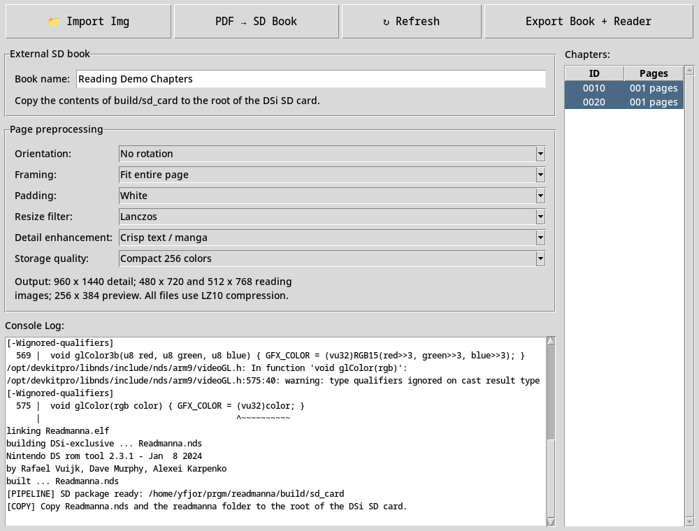

# Readmanna

Readmanna lets you read comics, manga, and documents on a **Nintendo DSi**.
It spreads one page across both screens, so you can hold the console upright
or turn the page sideways and read with the console like a book.

The desktop tools turn PDFs or folders of pictures into books for your SD
card. The DSi app opens those prepared books; it does not read PDFs directly.
You keep one small reader app on the card and add books whenever you like.

## Features

- A page uses both screens, with zoom, touch dragging, and D-pad panning.
- Rotate the view in either direction without converting the book again.
- Switch between books, move across chapters, or jump to a page number.
- Each book remembers your page, rotation, and zoom.
- Convert a whole PDF in one step, or organize images into your own chapters.
- Choose a compact 256-color format or full-color RGB555, with lossless LZ10
  compression after the page images are prepared.
- Use bicubic preprocessing on the computer, with cached lightweight resizing
  on the DSi, keeping all seven zoom levels and four image files per page.
- Replace an exported book while preserving its saved reading position.

This repository uses the latest Readmanna snapshot found locally:
`readmanna-preprocessed-480x720-512x768`. The source and checks are recorded in
[docs/origin.md](docs/origin.md).

## Screenshots





The current desktop exporter, with two sample chapters ready to export:



After exporting the sample book and building its reader:



These captures use an original two-page sample, not a personal book library.

## Set up the desktop tools

Install Python 3 and the [devkitPro NDS development tools](https://devkitpro.org/wiki/Getting_Started):
devkitARM, libnds, Calico, libfat, grit, and ndstool. The converter uses grit
even when you are only exporting a book. On Linux, also install Tk support
for Python, usually provided by `python3-tk`.

```bash
git clone https://github.com/Vjarkjan/readmanna.git
cd readmanna
python3 -m venv .venv
source .venv/bin/activate
python -m pip install -r requirements.txt
```

On Windows, use `py -m venv .venv` and `.venv\Scripts\activate` in Command
Prompt, then the same `python -m pip install` command. The tools look for
devkitPro in `DEVKITPRO` and common installation folders. Set `DEVKITPRO` if
you installed it elsewhere.

## Read your first PDF

Build the reusable reader once, then convert a PDF:

```bash
bash build_nds.sh
python pdf_to_book.py "/path/to/My Book.pdf"
```

The reader is `build/Readmanna.nds`. The converted book is under
`build/sd_card/readmanna/books/`. Copy the reader and the `readmanna` folder
to the root of your DSi SD card:

```text
SD card/
├── Readmanna.nds
└── readmanna/
    └── books/
        └── my-book/
            ├── book.cfg
            └── 0001/
                ├── page001_full.dsm
                ├── page001_zoom480.dsm
                ├── page001_zoom512.dsm
                └── page001_preview.dsm
```

Launch `Readmanna.nds` with a homebrew loader that provides **DSi mode and SD
access**. One available book opens automatically. With several books, choose
one from the book picker. This build is DSi-only; DS and DS Lite cannot run it.

To send a PDF straight to a mounted SD card, choose the card's root directory:

```bash
python pdf_to_book.py "My Book.pdf" --sd-root "/path/to/SD-card" --name "My Book"
```

This converts the book only. It does not build or copy `Readmanna.nds`.
Exporting another book name adds a book; reusing the same normalized name
replaces that book and retains its saved position where possible.

## Use the desktop window

```bash
python main_gui.py
```

For a PDF, click **PDF → SD Book** and choose the file. This follows the same
one-step conversion as `pdf_to_book.py` and writes to `build/sd_card`.

For pictures, click **Import Img** to open `assets/jpg_comic/`. Put each
chapter in a four-digit folder, such as `0010` or `0020`, then click
**Refresh**. Pages are sorted by filename: `2.jpg` comes before `10.jpg`.
JPG, PNG, BMP, WebP, and TIFF are common choices; other formats depend on the
codecs available to Pillow.

Enter a book name, select the chapters, and click **Export Book + Reader**.
Ctrl-click selects separate chapters; Shift-click selects a range. With no
selection, the app asks whether to export all chapters. This workflow also
builds and places `Readmanna.nds` in `build/sd_card`, so you can copy that
folder's contents to the card.

The default settings are **Fit entire page**, **White**, **Bicubic**,
**Crisp text / manga**, and **Compact 256 colors**. Change them for the image
book you are exporting. The one-step PDF button uses its own default settings.

### Image preprocessing and zoom

Both exporters default to bicubic resizing on the computer. Each page still
contains the same four LZ10-compressed images, with unchanged dimensions and
color formats. There are no additional zoom files or stored rotations.

| Zoom | Prepared source | DSi work when the view changes |
| --- | --- | --- |
| 1× | 256 × 384 preview | Copy pixels |
| 1.25× / 1.5× | 480 × 720 reading image | Bilinear resize to 320 × 480 / 384 × 576 |
| 1.875× | 480 × 720 reading image | Copy pixels |
| 2× | 512 × 768 reading image | Copy pixels |
| 2.5× / 3× | 960 × 1440 detail image | Bilinear resize to 640 × 960 / 768 × 1152 |

The reader prepares the displayed texture only when the page, zoom, or rotation
changes. Panning copies rows from that texture. The upright reading image stays
in the existing scratch buffer, avoiding repeated SD reads and decompression
for nearby zooms and rotations. Detail is loaded only for the two largest zooms
or when an older book lacks a reading image; older books retain an area-filtered
fallback for the smaller zooms.

Existing books work with the rebuilt reader immediately. Re-export to apply
bicubic filtering to books previously prepared with Lanczos. The pixel budget
is unchanged; exact compressed sizes depend on image content and filtering.
The two-page sample measured 640,440 bytes with bicubic versus 642,844 with
Lanczos using the GUI defaults (0.37% smaller); this is not a size guarantee
for every book.

## Buttons and shortcuts

| DSi control | Action |
| --- | --- |
| Drag with the stylus | Move the page |
| D-pad | Pan the view |
| X / Y | Next / previous page, including across chapters |
| L / R | Rotate clockwise / counterclockwise |
| Select / Start | Zoom in / out |
| Start + Select | Open the book picker |
| A | Return to minimum zoom and center the page |
| B | Open the page-number keypad for the current chapter |

In the book picker, Up/Down changes the selection, Left/Right moves by a
screenful, A opens a book, and B returns to reading when a book is already
open. In the page-number dialog, enter a number with the stylus, press A to
confirm, or B to cancel. D-pad panning follows the rotated view; touch dragging
follows your hand.

The desktop app uses normal Tk navigation: Tab moves between controls and
Ctrl/Shift-click extends chapter selections. It has no custom keyboard
shortcuts for building or exporting.

## Scripts

| File | What it does |
| --- | --- |
| `main_gui.py` | Opens the desktop exporter |
| `pdf_to_book.py` | Converts one PDF into a ready-to-copy book with one chapter |
| `pdf_importer.py` | Converts a PDF into chapter image folders for the GUI |
| `update_book_cfg.py` | Checks or rebuilds book manifests without changing page images |
| `build_nds.sh` | Builds only the reader; `--clean` removes old compiler output first |
| `Makefile` | Compiles the C++ reader in `source/main.cpp` |
| `build.bat` / `main_gui.spec` | Package the desktop GUI as `dist/main_gui.exe` on Windows |

To split a PDF into chapters of 20 pages before using the GUI:

```bash
python pdf_importer.py "My Book.pdf" --mode split --pages-per-chapter 20
```

Use `--mode toc` to follow top-level PDF bookmarks, or `--mode single` for
one chapter. `--raw` tries to extract each page's embedded image instead of
rendering the PDF. Each command-line Python tool provides `--help`.

To check existing book files before updating their manifests:

```bash
python update_book_cfg.py "/path/to/SD-card" --dry-run
python update_book_cfg.py "/path/to/SD-card"
```

The Windows packaging script installs PyInstaller if needed. Its executable
does not include the C++ build project: copy `dist/main_gui.exe` into the
repository root, beside `Makefile`, `source/`, and `icon.bmp`, before using
**Export Book + Reader**. devkitPro is still required. Windows packaging has
not been tested in this repository setup.

## Book files and current limits

Keep each `book.cfg` with its chapter folders: it holds the title, page counts,
and saved position. The current format is `DS_MANGAMAN_BOOK_V3_ASSET`; books
from incompatible older formats need to be exported again. The reader supports
up to 128 books and 256 chapters per book. Prepared images use more SD space
than some source PDFs, especially in full-color mode.

The reader build, PDF conversion, manifest maintenance, and desktop GUI were
checked on Linux. A new physical DSi session was not tested during this
repository setup. See [the validation record](docs/verification.md) and
[the original technical notes](docs/previous-readme.md) for more detail.
